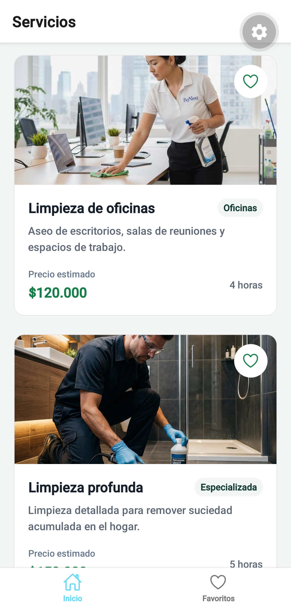
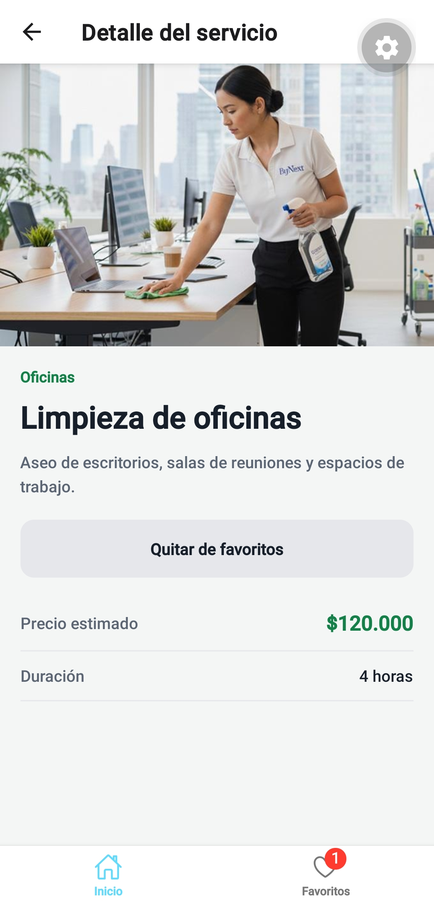
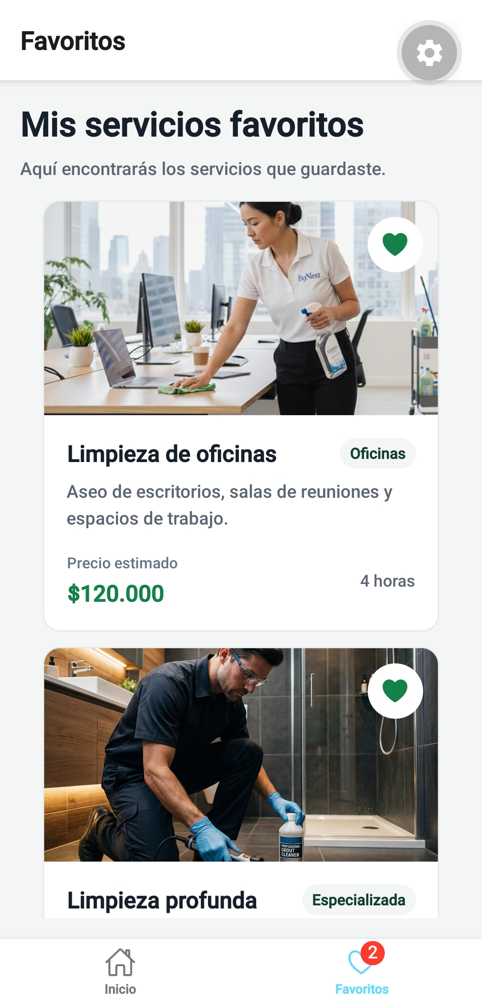

# CleanPro

CleanPro es una aplicación móvil de ejemplo para consultar servicios de una empresa de limpieza residencial y comercial. La Semana 04 conserva el catálogo, la búsqueda y la navegación existentes, y centraliza los favoritos en Zustand con persistencia local.

## Dominio

Empresa de limpieza residencial y comercial. El catálogo presenta servicios ficticios con categorías, descripciones, precios estimados en pesos colombianos y duración aproximada.

## Funcionalidades

- Catálogo de 12 servicios mediante `FlatList`.
- Búsqueda por nombre, descripción y categoría, sin distinguir mayúsculas ni tildes.
- Limpieza de la consulta y mensaje personalizado cuando no hay resultados.
- Ajuste de pantalla para el teclado.
- Tarjetas reutilizables con información de los servicios.
- Navegación por pestañas entre Inicio y Favoritos.
- Navegación Stack desde el catálogo hasta el detalle de un servicio.
- Envío de `id` y `name` mediante parámetros de navegación tipados.
- Agregar y quitar favoritos desde las tarjetas o el detalle.
- Estado global de favoritos con Zustand y persistencia con AsyncStorage.
- Badge en la pestaña Favoritos con el total guardado; se oculta cuando está vacío.
- Pantalla de carga mientras se recuperan los favoritos y reintento si falla la lectura.

## Tecnologías

- Expo SDK `58.0.17`
- React `19.3.0`
- React Native `0.88.0`
- TypeScript `6.0.3`
- React Navigation 7
- Zustand 5
- AsyncStorage `2.2.0`
- `@expo/vector-icons`
- `pnpm`

## Instalación y ejecución

Desde la raíz del proyecto, ejecuta:

```bash
pnpm install
pnpm start
```

Abre la aplicación en Expo Go o en un emulador compatible. También puedes utilizar `pnpm android`, `pnpm ios` o `pnpm web`, si estos comandos están configurados en `package.json`.

## Navegación

La aplicación utiliza dos niveles de navegación:

- **Bottom Tabs:** permite cambiar entre Inicio y Favoritos.
- **Native Stack:** permite navegar desde el catálogo hasta el detalle de un servicio.

La navegación se encuentra tipada mediante `RootTabParamList` y `HomeStackParamList`. Desde Favoritos se abre el mismo detalle dentro del Stack de Inicio.

## Pantallas

### Inicio

Presenta el catálogo de servicios y la búsqueda. Cada servicio permite acceder a su pantalla de detalle. El corazón de cada tarjeta agrega o quita el favorito sin abrir el detalle.

### Detalle del servicio

Muestra la información del servicio seleccionado y recibe su identificador y nombre mediante parámetros tipados. Su botón permite agregar o quitar el favorito y refleja los cambios del estado global.

### Favoritos

Obtiene los identificadores desde Zustand y resuelve los servicios contra el catálogo existente. Permite quitar un favorito desde la tarjeta o abrir su detalle.

## Estado global y persistencia

`src/stores/favoritesStore.ts` es la única fuente de favoritos. Usa `create<FavoritesStore>()`, el estado `favoriteIds: string[]` y las acciones inmutables `addFavorite(id)` y `removeFavorite(id)`. Agregar un ID existente no lo duplica.

El middleware `persist` utiliza `createJSONStorage(() => AsyncStorage)` y la clave `cleanpro-favorites`. `partialize` guarda únicamente `favoriteIds`; los datos completos del catálogo, las acciones y el estado de hidratación no se almacenan.

`onRehydrateStorage` controla los estados `loading`, `ready` y `error`. `App.tsx` espera a `ready` antes de montar la navegación para evitar listas vacías o corazones incorrectos durante el inicio. Si falla la lectura, muestra un reintento. El estado temporal de hidratación utiliza el setter original de Zustand para no escribir sobre los favoritos guardados.

Las pantallas seleccionan únicamente los IDs, las acciones o el booleano que necesitan. `ItemCard` recibe el estado y el callback desde su pantalla. `RootNavigator` selecciona `favoriteIds.length` para actualizar `tabBarBadge` automáticamente.

## Diseño y estructura

La interfaz conserva la identidad visual de CleanPro: encabezado verde oscuro, fondo claro y tarjetas blancas. Los colores, tamaños de texto y espacios reutilizables se centralizan en `src/theme/index.ts`.

El catálogo utiliza datos locales de prueba y no requiere conexión a una API externa.

Estructura principal:

```text
src/
├── components/
├── data/
├── navigation/
├── screens/
├── stores/
├── theme/
└── types/


App.tsx
README.md
```

## Verificación de la Semana 04

```bash
pnpm typecheck
pnpm test
pnpm dlx expo-doctor
```

Las pruebas usan el ejecutor de Node.js, el store real y Zustand. Solo sustituyen AsyncStorage por almacenamiento asíncrono en memoria. Comprueban acciones inmutables, ausencia de duplicados, persistencia exclusiva de IDs, restauración en otra instancia, lectura demorada, errores, reintento y suscripción al total.

Resultados de esta entrega: TypeScript sin errores, ocho pruebas aprobadas y exportación del bundle Android con Metro completada (967 módulos). La exportación comprueba la resolución de imports y assets; no ejecuta la aplicación en Android.

Estas pruebas no validan el almacenamiento nativo ni sustituyen cerrar completamente la aplicación y abrirla nuevamente en Android.

La ejecución de Expo Doctor durante esta entrega aprobó 19 de 20 controles. Detectó diferencias en versiones ya declaradas antes de la migración:

| Paquete | Instalado | Esperado por Doctor |
| --- | --- | --- |
| `expo` | `58.0.17` | `~58.0.23` |
| `expo-font` | `58.0.9` | `~58.0.11` |
| `react-native` | `0.88.0` | `0.88.1` |
| `react-native-safe-area-context` | `5.10.1` | `~5.11.1` |
| `react-native-screens` | `4.30.0` | `~4.30.1` |

La alineación de estas versiones queda pendiente; esta migración conserva las dependencias y el lockfile existentes.

### Comprobación manual en Android

1. Ejecuta `pnpm start` y abre el proyecto en Expo Go compatible o usa `pnpm android` con un emulador configurado.
2. Comprueba la búsqueda por nombre, categoría y descripción, incluidas tildes y limpieza de consulta.
3. Pulsa el corazón de dos tarjetas. Confirma que no se abre el detalle, que los corazones cambian y que el badge indica `2`.
4. Abre Favoritos. Comprueba los mismos dos servicios y abre uno de sus detalles. Verifica nombre, imagen, precio y duración.
5. Quita y vuelve a agregar ese favorito desde el detalle. Confirma que la lista, las tarjetas y el badge se sincronizan.
6. Cierra completamente la aplicación desde aplicaciones recientes o mediante «Forzar detención». No borres sus datos ni la reinstales.
7. Abre nuevamente el proyecto. Confirma que los favoritos, corazones y badge se restauran sin mostrar temporalmente un estado vacío.
8. Quita todos los favoritos. Comprueba el mensaje vacío y que el badge desaparece. Repite el cierre completo y la apertura; debe continuar vacío.
9. Comprueba el botón Atrás de Android y el regreso entre las pestañas y el detalle.

Estas comprobaciones manuales quedan pendientes hasta ejecutarse en un dispositivo físico o emulador.

## Capturas de evidencia

Las capturas de pantalla se almacenan en la carpeta `screenshots/`, ubicada en la raíz del proyecto. Screenshots de evidencia de la semana 04.

### 01 — Pantalla principal



### 02 — Detalle de servicio



### 03 — Favoritos y badge



### 04 — Persistencia


